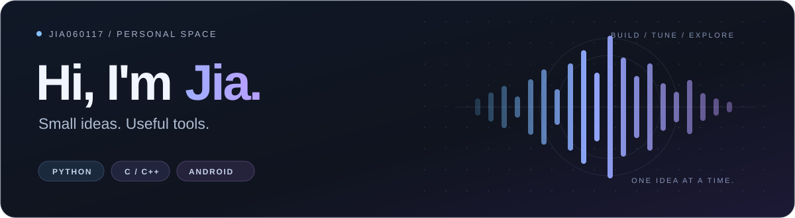

  

<h3 align="center">把想法，做成用得上的小工具。</h3>

  你好，我是佳（Jia） · <a href="https://github.com/Jia060117">@Jia060117</a> 
  这里记录我的工具、实验，以及一点点折腾的过程。

  <a href="#projects">项目 Projects</a> &nbsp; / &nbsp;
  <a href="#exploring">探索 Exploring</a> &nbsp; / &nbsp;
  <a href="https://github.com/Jia060117?tab=repositories">全部仓库 ↗</a>

 

<h2 id="projects">精选项目 Selected projects</h2>

<table>
  <tr>
    <td width="50%" valign="top">
      <h3>01 / 音乐，让衔接更自然</h3>
      
<a href="https://github.com/Jia060117/AutomixFor163Music"><strong>AutomixFor163Music ↗</strong></a>

      
为网易云音乐 Windows 客户端带来自动衔接与节拍混音，让歌曲切换更平滑。

      
<code>音频分析</code> <code>智能淡入淡出</code> <code>Windows</code>

    </td>
    <td width="50%" valign="top">
      <h3>02 / 设备，让画面可见</h3>
      
<a href="https://github.com/Jia060117/Remote-Phone-Monitor"><strong>Remote-Phone-Monitor ↗</strong></a>

      
面向自有或已获明确授权的 Android 设备，自托管屏幕采样与浏览器时间轴查看。

      
<code>Android</code> <code>C++</code> <code>FastAPI</code>

    </td>
  </tr>
</table>

 

<h2 id="exploring">折腾的方向 Things I explore</h2>

- **桌面与音频** — 从日常听歌出发，尝试改善工具的使用体验。
- **Android 与自托管** — 设备端、服务端和浏览器之间的连接。
- **嵌入式与物联网** — <a href="https://github.com/Jia060117/-LoRa-">LoRa 通用工程</a>，记录相关实践。

 

  BUILD A LITTLE. LEARN A LITTLE. KEEP GOING.

